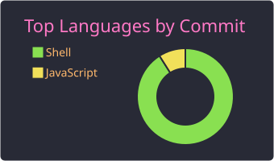
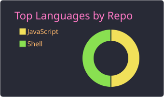
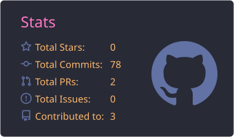
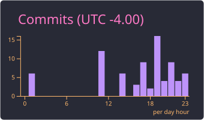
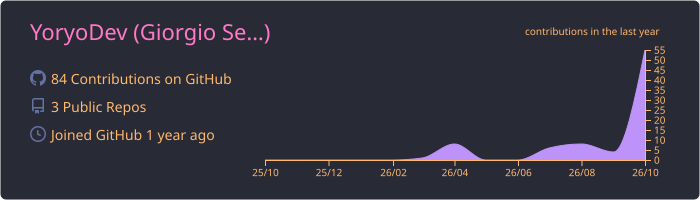

<picture>
  <source media="(prefers-color-scheme: dark)" srcset="assets/banner-dark.svg">
  <source media="(prefers-color-scheme: light)" srcset="assets/banner-light.svg">
  
</picture>

# Giorgio Sebastian Lopez Poiqui

[**ES** Español](README.md) · **EN** English

## 👋 About me

- Junior software developer with close to 1 year of hands-on experience.
- Specializing in back-end with **C# and .NET**: REST APIs, JWT, data migration and sync.
- Front-end with **Angular, React and Tailwind CSS**: reusable, responsive components.
- I care about clean architecture: N-layer, modular monolith, hexagonal.

## 🧠 How I work

- 📚 **Self-taught:** I enjoy learning new technologies on my own.
- 🚀 **Proactive:** I propose ideas and move forward without waiting to be asked.
- 🤝 **Teamwork:** I adapt and collaborate with multidisciplinary teams.
- ⏱️ **Under pressure:** I meet demanding deadlines and deliverables.

## 🛠️ Stack

**Back-end**

**Front-end**

**Tools**

## 🌱 Currently

- Deepening my knowledge of .NET and software architecture.
- Improving my English (A2).

## 📈 GitHub Activity

  

  
  

  
  

  

## 📫 Contact

