<picture>
  <source media="(prefers-color-scheme: dark)" srcset="assets/banner-dark.svg">
  <source media="(prefers-color-scheme: light)" srcset="assets/banner-light.svg">
  
</picture>

# Giorgio Sebastian Lopez Poiqui

🇪🇸 Español · [🇬🇧 English](README.en.md)

## 👋 Sobre mí

- Desarrollador de software junior con cerca de 1 año de experiencia práctica.
- Me especializo en back-end con **C# y .NET**: APIs REST, JWT, migración y sincronización de datos.
- En front-end trabajo con **Angular, React y Tailwind CSS**: componentes reutilizables y responsive.
- Me importa la arquitectura limpia: N capas, monolito modular, hexagonal.

## 🧠 Cómo trabajo

- 📚 **Autodidacta:** disfruto aprender tecnologías nuevas por mi cuenta.
- 🚀 **Proactivo:** propongo y avanzo sin esperar a que me lo pidan.
- 🤝 **Trabajo en equipo:** me adapto y colaboro con perfiles multidisciplinarios.
- ⏱️ **Bajo presión:** cumplo con entregas y plazos exigentes.

## 🛠️ Stack

**Back-end**

**Front-end**

**Herramientas**

## 🌱 Actualmente

- Profundizando en .NET y arquitectura de software.
- Mejorando mi inglés (A2).

## 📈 Actividad en GitHub

  

  
  

  
  

  

## 📫 Contacto

